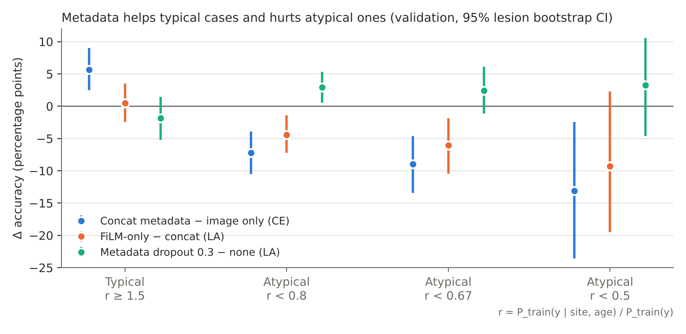
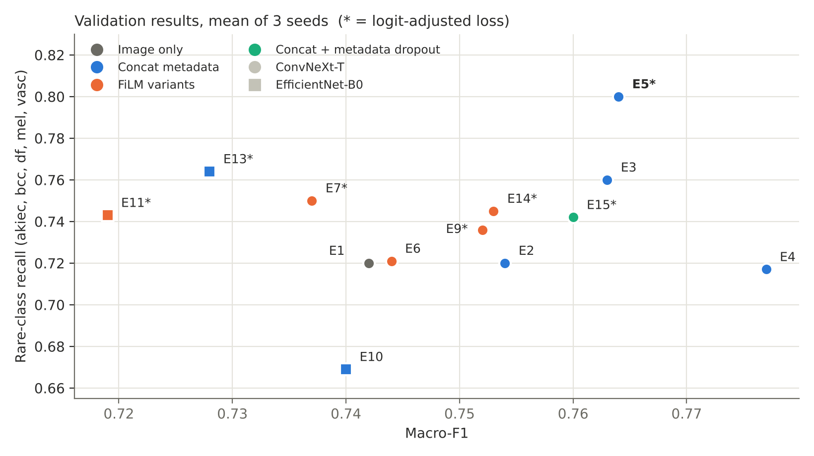
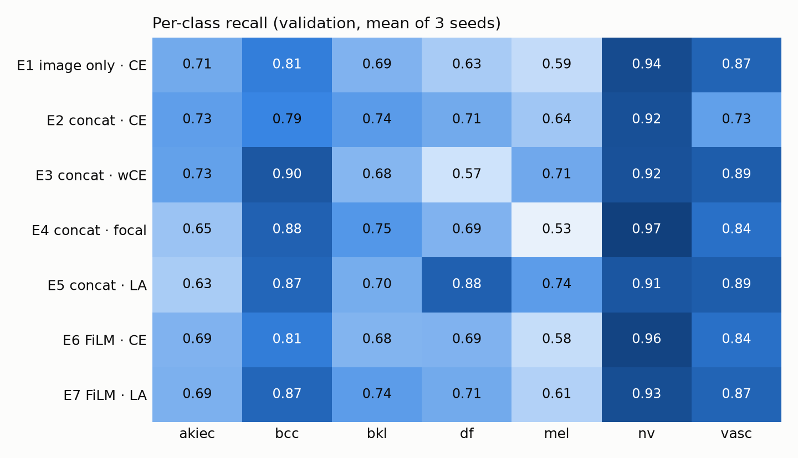
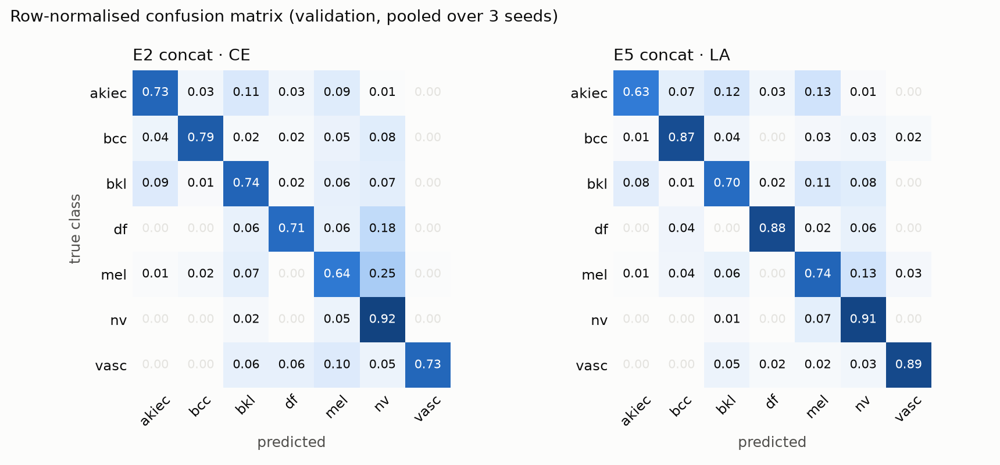
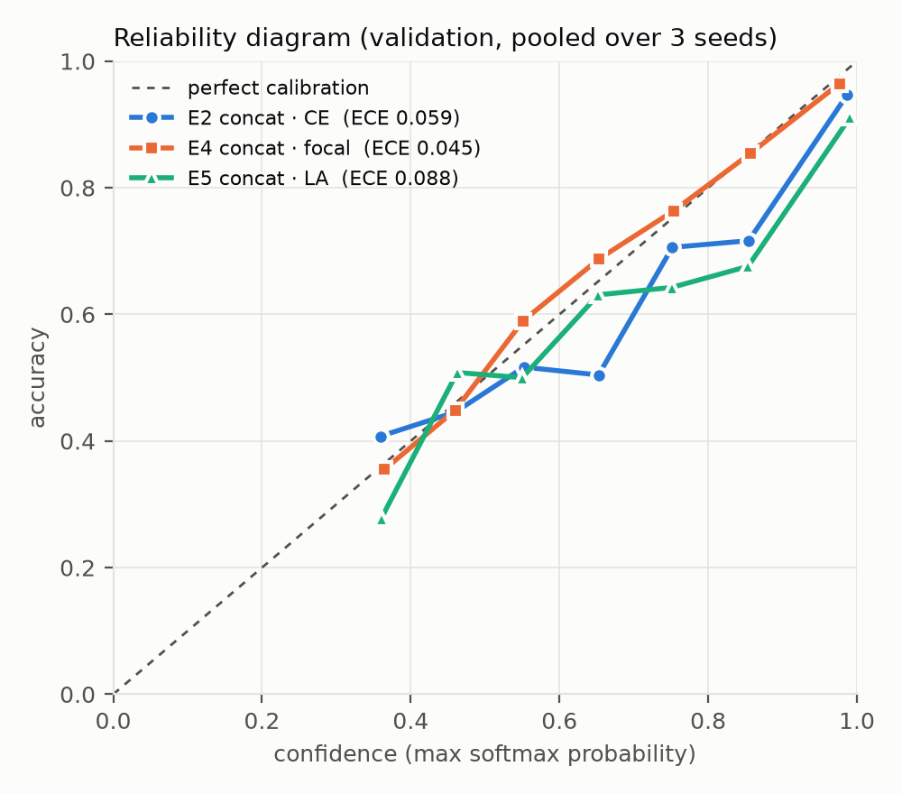
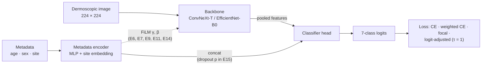

<div align="center">

# Metadata as a Shortcut in Skin Lesion Classification

**7-class dermoscopy classification on HAM10000 with patient metadata, long-tail losses and a leakage-free protocol**

[](https://github.com/duty00/Deep-Learning/actions/workflows/ci.yml)


-lightgrey)


CO3133 Deep Learning and Applications · HCMUT · Semester 252

[Key findings](#key-findings) ·
[Results](#results) ·
[Method](#method) ·
[Quick start](#quick-start) ·
[Reproduce](#reproducing-the-experiments) ·
[Repository layout](#repository-layout)

</div>

---

Dermatology models often take age, sex and anatomical site as extra input. We ask a narrower question than
"does metadata help": **for which patients does it help, and for which does it hurt?** Every model is trained
on a lesion-disjoint split with three seeds, and every comparison is a lesion-level paired bootstrap.

> [!IMPORTANT]
> All numbers on this page are on the **validation** split. The held-out test split is locked and will be
> scored exactly once, after the final configuration is chosen (see [test-set protocol](#test-set-protocol)).

## Key findings

| | Finding | Evidence (validation) |
|---|---|---|
| 1 | **Late-fused metadata is a prior shortcut.** It improves cases whose label is typical for the patient's site and age, and hurts atypical ones, with a dose–response pattern. | Concat vs image only: typical **+5.7 pp** [+2.5, +9.0], atypical r<0.67 **−9.0 pp** [−13.5, −4.6], r<0.5 **−13.1 pp** |
| 2 | **Logit adjustment is the only change that clearly lifts rare classes.** Replicates on a second backbone. | E5 vs E2: rare recall 0.720 → **0.800**, melanoma recall 0.641 → **0.737**; same direction on EfficientNet-B0 (E13 vs E10) |
| 3 | **FiLM does not remove the shortcut.** Conditioning the backbone instead of the head makes atypical cases *worse*, even though FiLM is active (\|γ\| ≈ 0.15–0.18). | FiLM-only vs concat (LA), atypical r<0.67: **−6.0 pp** [−10.4, −1.8] |
| 4 | **Metadata dropout partially mitigates it,** at a cost in rare-class recall. | Dropout 0.3 vs none, atypical r<0.8: **+2.9 pp** [+0.6, +5.3]; rare recall 0.800 → 0.742 |

<p align="center">
  
</p>

*Typicality ratio* r = P<sub>train</sub>(y | site group, age group) / P<sub>train</sub>(y), computed from the
training split only. r < 1 means the true label is rarer than usual for that kind of patient.

## Results

<p align="center">
  
</p>

Mean ± std over seeds 42, 43 and 44. **Bold** marks the best value in a column.

| ID | Backbone | Metadata | Loss | Macro-F1 | Bal. acc. | Rare recall | Mel recall |
|:--|:--|:--|:--|:--:|:--:|:--:|:--:|
| E1 | ConvNeXt-T | – | CE | 0.742 ± 0.009 | 0.746 | 0.720 | 0.586 |
| E2 | ConvNeXt-T | concat | CE | 0.754 ± 0.036 | 0.752 | 0.720 | 0.641 |
| E3 | ConvNeXt-T | concat | weighted CE | 0.763 ± 0.022 | 0.771 | 0.760 | 0.711 |
| E4 | ConvNeXt-T | concat | focal | **0.777 ± 0.021** | 0.757 | 0.717 | 0.530 |
| **E5** | ConvNeXt-T | concat | logit-adjusted | 0.764 ± 0.017 | **0.801** | **0.800** | **0.737** |
| E6 | ConvNeXt-T | FiLM + concat | CE | 0.744 ± 0.015 | 0.750 | 0.721 | 0.582 |
| E7 | ConvNeXt-T | FiLM + concat | logit-adjusted | 0.737 ± 0.010 | 0.774 | 0.750 | 0.612 |
| E9 | ConvNeXt-T | FiLM (stage 3) + concat | logit-adjusted | 0.752 ± 0.020 | 0.766 | 0.736 | 0.639 |
| E14 | ConvNeXt-T | FiLM only | logit-adjusted | 0.753 ± 0.029 | 0.770 | 0.745 | 0.630 |
| E15 | ConvNeXt-T | concat + dropout 0.3 | logit-adjusted | 0.760 ± 0.016 | 0.769 | 0.742 | 0.653 |
| E10 | EfficientNet-B0 | concat | CE | 0.740 ± 0.007 | 0.716 | 0.669 | 0.558 |
| E11 | EfficientNet-B0 | FiLM + concat | logit-adjusted | 0.719 ± 0.021 | 0.760 | 0.743 | 0.673 |
| E13 | EfficientNet-B0 | concat | logit-adjusted | 0.728 ± 0.003 | 0.775 | 0.764 | 0.675 |

Rare classes (fixed before training): `akiec`, `bcc`, `df`, `mel`, `vasc`. No macro-F1 difference between
configurations is significant under the paired bootstrap; the differences that are significant are in
rare-class recall and in the metadata subgroups above.

<details>
<summary><b>More results: data-size ablation, per-class recall, calibration</b></summary>

<br>

| ID | Training data | Loss | Macro-F1 | Rare recall |
|:--|:--:|:--|:--:|:--:|
| E12a | 25 % | CE | 0.632 ± 0.007 | 0.526 |
| E12e | 25 % | logit-adjusted | 0.650 ± 0.015 | 0.617 |
| E12b | 50 % | CE | 0.736 ± 0.010 | 0.704 |
| E12f | 50 % | logit-adjusted | 0.737 ± 0.001 | 0.727 |

<p align="center">
  
</p>
<p align="center">
  
  
</p>

Full tables: [`reports/tables/results_validation.csv`](reports/tables/results_validation.csv),
[`reports/tables/paired_bootstrap_validation.csv`](reports/tables/paired_bootstrap_validation.csv),
per-run records in [`experiments/results.csv`](experiments/results.csv).

</details>

## Method



| Component | Choices studied |
|---|---|
| Backbone | `convnext_tiny.in12k_ft_in1k`, `efficientnet_b0.ra_in1k` (timm, ImageNet-pretrained) |
| Fusion | none · late concat · FiLM on backbone stages + concat · FiLM only · concat with per-sample metadata dropout |
| Loss | cross-entropy · class-weighted CE · focal · logit-adjusted CE (Menon et al., 2021) |
| Protocol | 70 / 15 / 15 split by `lesion_id` (7,011 / 1,502 / 1,502 images), 3 seeds, lesion-level paired bootstrap |

## Quick start

```bash
git clone https://github.com/duty00/Deep-Learning.git && cd Deep-Learning
python -m venv .venv && source .venv/bin/activate          # Windows: .venv\Scripts\activate
pip install torch torchvision --index-url https://download.pytorch.org/whl/cu128   # choose your CUDA build
pip install -e ".[train]"
python -m unittest discover -s tests
```

> [!NOTE]
> Install the CUDA build of PyTorch **before** `.[train]`, otherwise pip pulls the CPU build from PyPI.
> Exact versions used for the experiments are in [`requirements-lock.txt`](requirements-lock.txt)
> (Kaggle, Python 3.13, 2× Tesla T4).

**Data.** Download HAM10000 (Tschandl et al., 2018; CC BY-NC 4.0), e.g. the Kaggle mirror
`kmader/skin-cancer-mnist-ham10000`, into `data/raw/ham10000/`, then check it against the committed split:

```bash
python scripts/make_splits.py --verify
```

See [`data/README.md`](data/README.md) and [`scripts/download_data.md`](scripts/download_data.md) for details.

## Reproducing the experiments

```bash
# train and evaluate one configuration / seed
python -m dl_project train    --config configs/experiments/e05_concat_la.json --seed 42
python -m dl_project evaluate --config configs/experiments/e05_concat_la.json --seed 42 \
       --checkpoint outputs/e05_concat_la-s42/train/<run-id>/best.pt --split validation

# aggregate all runs and analyse
python scripts/aggregate_results.py --split validation   # mean ± std tables
python scripts/analyze_results.py   --split validation   # paired bootstrap, figures
python scripts/analyze_shortcut.py  --split validation   # metadata-typical vs atypical subgroups
```

| Option | Effect |
|---|---|
| `--debug` | 2 epochs × 8 batches, pipeline smoke test |
| `--micro-batch-size N` | lowers VRAM only; gradient accumulation keeps the effective batch at 32 |

Each run writes `outputs/<experiment>-s<seed>/<train|evaluate>/<UTC-id>/` with the resolved config, git
commit, environment, `train.log`, `history.csv`, `best.pt`, `metrics.json` and `predictions.csv`.
All planned runs are listed in [`experiments/matrix.csv`](experiments/matrix.csv);
[`notebooks/kaggle_runner.ipynb`](notebooks/kaggle_runner.ipynb) runs them two at a time on Kaggle's 2× T4.

### Test-set protocol

`evaluate` requires an explicit `--split`. Scoring `test` additionally requires `--final-test`; each test
evaluation is appended to `experiments/test_log.csv`, and re-scoring a checkpoint is refused unless
`--allow-repeat-test` is passed (which must then be reported).

## Repository layout

```text
├── configs/
│   ├── baseline.json            shared defaults
│   └── experiments/             one JSON per experiment (generated by scripts/make_configs.py)
├── data/splits/manifest.json    lesion-disjoint split, image ids + metadata SHA-256 (no images in Git)
├── src/dl_project/
│   ├── data/                    dataset, metadata encoder, transforms, split logic
│   ├── models/                  staged timm backbones, FiLM, classifier
│   ├── engine/                  trainer, losses, seeding
│   ├── metrics/                 metrics, lesion-level bootstrap CIs, ECE, efficiency
│   └── tasks/, cli.py           train / evaluate entry points
├── scripts/                     splits, config generation, aggregation, analysis
├── experiments/                 experiment matrix and per-run results
├── reports/                     figures and tables used in the report
├── notebooks/                   EDA and the Kaggle batch runner
├── tests/                       unit tests (run in CI)
└── docs/                        assignment, proposal, team, hardware, attribution, checkpoints
```

## Attribution

Backbones and pretrained weights come from
[timm](https://github.com/huggingface/pytorch-image-models) (Apache-2.0). The metadata encoder, FiLM layer,
classifier, losses, training loop, split logic and analysis scripts are our own implementation. FiLM follows
Perez et al. (AAAI 2018); logit adjustment follows Menon et al. (ICLR 2021). Full list in
[`docs/ATTRIBUTION.md`](docs/ATTRIBUTION.md). Checkpoints are not stored in Git; links will be added to
[`docs/CHECKPOINTS.md`](docs/CHECKPOINTS.md) before submission.

<details>
<summary><b>Dataset citation</b></summary>

```bibtex
@article{tschandl2018ham10000,
  title   = {The HAM10000 dataset, a large collection of multi-source dermatoscopic images of common pigmented skin lesions},
  author  = {Tschandl, Philipp and Rosendahl, Cliff and Kittler, Harald},
  journal = {Scientific Data},
  volume  = {5},
  pages   = {180161},
  year    = {2018}
}
```

</details>

## Team

Group of three students, CO3133 (HCMUT). Roles are listed in [`docs/TEAM.md`](docs/TEAM.md).
This is a course project, **not** a diagnostic tool.
